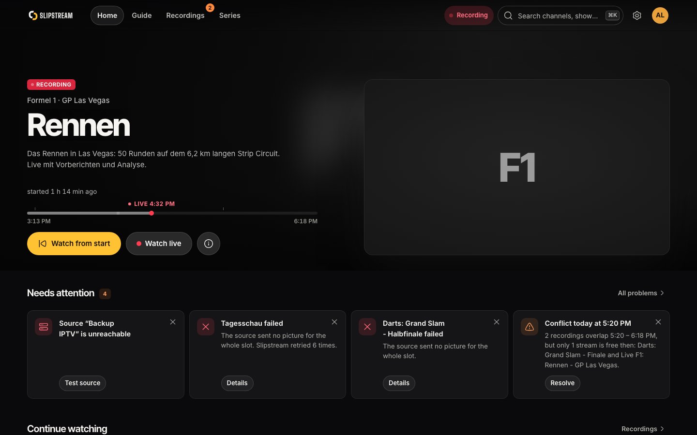
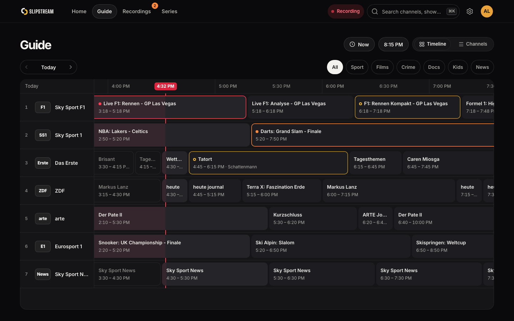
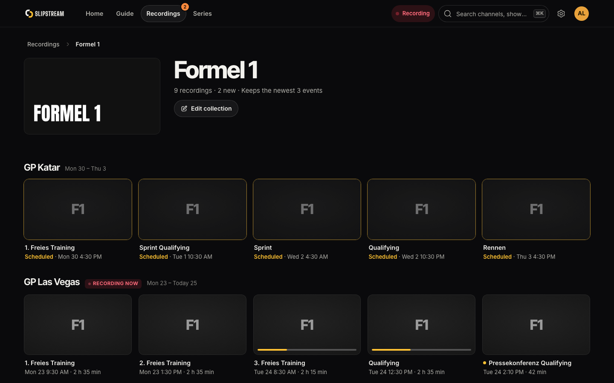

<p align="center">
  <picture>
    <source media="(prefers-color-scheme: dark)" srcset="docs/design/brand/lockup-horizontal-dark.svg">
    
  </picture>
</p>

<p align="center">
  <a href="https://github.com/ZerNico/slipstream/actions/workflows/ci.yml"></a>
  <a href="https://github.com/ZerNico/slipstream/actions/workflows/docker.yml"></a>
  <a href="https://github.com/ZerNico/slipstream/releases/latest"></a>
  <a href="LICENSE"></a>
</p>

Slipstream is a self-hosted live TV and DVR server for IPTV sources (M3U + XMLTV), with its own
web app and an Android app for phones and Android TV.



| Guide                                                | A collection, grouped by event                                     |
| ---------------------------------------------------- | ------------------------------------------------------------------ |
|  |  |

## Features

**Live TV and timeshift**

- Pause, rewind and jump back to live on any channel
- Join a programme late and watch it from its start, while it is still on air
- One upstream connection per channel, shared by every viewer and recording
- Guide grid and now/next per channel, with search across titles and descriptions

**Recording**

- Record a single programme, a time range, or every airing of a series ("series recordings")
- Series recordings match on channel, title conditions, category and weekday, with extra time
  before and after
- Skips episodes you already have; when a recording fails or has gaps, records a later repeat
  and swaps it in
- Watch any recording while it is still being recorded
- Stream-limit conflicts are shown when scheduling; recordings win over live viewing
- Automatic reconnect on stream drops, with gaps reported ("missing 00:42 at 13:12")
- Retention per series or collection (newest N, newest N events, or by age), protected
  recordings, and a free-space guard

**Library**

- Grouped automatically by show and season from guide data, or by title and date
- Optional collections with their own layout (for example `Formel 1 › 2026 › GP Las Vegas`)
- Views by collection, channel or date; continue watching and watched state per person
- Artwork from the guide, frames grabbed from the recording, or TMDB (with your own key)

**Playback**

- HLS everywhere; stored recordings are the original stream, never re-encoded
- Per-session playback decision from what the device can decode; hardware encoders (NVENC,
  Quick Sync, VAAPI) are detected at startup. Converting on the fly is not finished yet: today
  everything plays direct

**People and devices**

- Admin and user roles, profiles with optional PINs, restricted profiles (channels,
  collections, whether they may record, stream limits)
- Guests invited by link, with their own access policy
- TV sign-in with a QR code and short code approved from a phone; server discovery on the LAN
- Every device has its own revocable token

**Sources and channels**

- M3U playlists with XMLTV guides, refreshed on a schedule; custom headers per source
- Stream picker for big playlists (thousands of streams in groups), new streams join their
  channel by guide id
- Several streams per channel with automatic fallback; per-source stream limits
- Guide clean-up: duplicate removal and title rewrites
- Source credentials are encrypted at rest

## Status

Slipstream is early, pre-1.0 software under active development. Expect breaking changes, read
the [release notes](https://github.com/ZerNico/slipstream/releases) and back up `/config` before
updating. Xtream Codes, HDHomeRun and single-URL sources, exporting recordings to files,
and on-the-fly transcoding are designed but not implemented.

## Getting started

Docker Compose is the way to run it. The image, `ghcr.io/zernico/slipstream`, contains the
server, the web app and a pinned ffmpeg, for amd64 and arm64. No clone needed: fetch the compose
file and start it.

```sh
mkdir slipstream && cd slipstream
curl -fsSLO https://raw.githubusercontent.com/ZerNico/slipstream/main/docker-compose.yml
docker compose up -d
```

Or write a minimal one yourself:

```yaml
services:
  slipstream:
    image: ghcr.io/zernico/slipstream:latest
    ports:
      - "8080:8080"
    environment:
      SLIPSTREAM_TIME_ZONE: Europe/Berlin
    volumes:
      - config:/config
      - data:/data
    restart: unless-stopped

volumes:
  config:
  data:
```

Open http://localhost:8080 and create the admin account. Then add your source (playlist URL and,
if it is separate, the guide URL) under Settings › Sources & channels.

No IPTV subscription to try it with? The `demo` profile of the repository's compose file also
starts a fake source with test channels and a guide:

```sh
docker compose --profile demo up -d
```

Add a source with the playlist `http://fake-source:8090/playlist.m3u` and the guide
`http://fake-source:8090/epg.xml`.

The two volumes are `/config` (database and `secret.key`; **back it up**) and `/data`
(recordings, about 3–4 GB per channel-hour). See [docs/configuration.md](docs/configuration.md)
before putting it behind a reverse proxy.

**Image tags:** `latest` is the newest release, `0.1.0` an exact one, `0.1` the newest patch of
a minor version, and `edge` the main branch. To update, back up `/config`, then
`docker compose pull && docker compose up -d`.

## Configuration

A few environment variables cover bootstrap settings: time zone, public URL, trusted proxies,
paths and ffmpeg. Everything else is configured in the web app.
[docs/configuration.md](docs/configuration.md) lists every variable, the volumes, reverse proxy
setup and backups.

## Apps

- **Web:** served by the server at its own address. Works on desktop and phone, and can be
  installed as a PWA.
- **Android phone and Android TV:** one app for both. Download the APK from the
  [Releases page](https://github.com/ZerNico/slipstream/releases) and install it on your phone or
  TV (on a TV, for example with a downloader app or `adb install`); it runs on arm64, 32-bit ARM
  and x86_64 devices. It finds servers on the local network, and a TV signs in by scanning a QR
  code with your phone. To build it yourself, see [apps/app/README.md](apps/app/README.md).

## Development

You need Node 26, pnpm (via corepack) and ffmpeg 8 or newer. A fake IPTV source ships with the
repository, so no subscription is needed.

```sh
pnpm install
pnpm run doctor   # checks the toolchain and says how to fix what is missing
pnpm dev          # fake source, server and web app; prints the URL and a dev login
```

[CONTRIBUTING.md](CONTRIBUTING.md) covers tests, conventions and the Android workflow;
[docs/architecture.md](docs/architecture.md) explains how it works.

## License

[AGPL-3.0](LICENSE).
